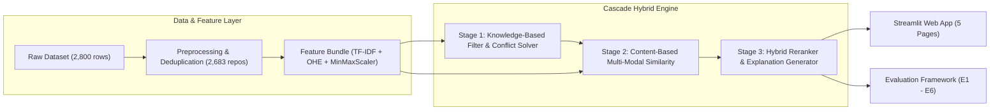
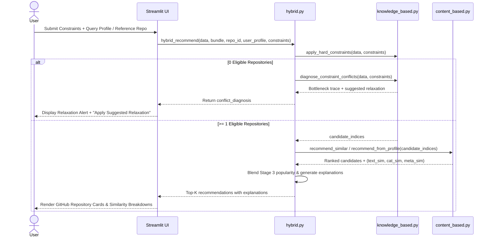

# RepoMatch — Hybrid GitHub Repository Recommendation System

RepoMatch is a **Hybrid Recommender System** for discovering open-source GitHub repositories based on explicit developer constraints, technical interests, and reference repositories. It combines a **Knowledge-Based (Constraint) Engine** and a **Content-Based (TF-IDF + Metadata) Engine** via **Cascade Hybridization**, complete with natural-language explanations, constraint conflict diagnosis, an offline evaluation framework (`E1`–`E6`), and a five-page GitHub Primer Dark Streamlit web application.

---

## 1. Recommendation Modes

| Mode | User Input | Recommendation Strategy |
| :--- | :--- | :--- |
| **Mode 1: Similar Repositories** | Existing GitHub repository (e.g., `tensorflow/tensorflow`, `vuejs/vue`) + optional language/similarity filters | Multi-modal Content-Based similarity ($0.65\,S_{\text{text}} + 0.25\,S_{\text{category}} + 0.10\,S_{\text{metadata}}$) over constraint-eligible candidates |
| **Mode 2: Find My Project** | Mandatory constraints (language, min stars, min forks, active status) + soft preferences (description keywords, topics, recency, popularity weight) | 3-stage Cascade Hybridization with automatic constraint conflict resolution when 0 repositories match |

---

## 2. Cascade Hybrid Architecture & Mathematical Formulation

### Three-Stage Cascade Pipeline
1. **Stage 1 — Knowledge-Based Filtering (Hard Constraints):**
   Eliminates candidate repositories that violate mandatory requirements (`language`, `min_stars`, `min_forks`, `include_archived`, `max_days_since_update`). If zero repositories survive, `diagnose_constraint_conflicts()` identifies the bottleneck constraint(s) and suggests data-driven relaxations without silently violating hard constraints.
2. **Stage 2 — Content-Based Similarity Scoring:**
   Represents each repository across three feature groups:
   - **Textual TF-IDF Matrix ($2683 \times 4002$):** Weighted combination of normalized descriptions, extracted technical topics, and repository names (`ngram_range=(1, 2)`, `min_df=2`, `max_df=0.90`, `sublinear_tf=True`), preserving technical tokens (`c++`, `c#`, `.net`, `r`, `c`, `go`).
   - **Categorical One-Hot Matrix ($2683 \times 64$):** Standardized programming language (`36` languages) and primary category bucket (`28` buckets).
   - **Scaled Numerical Metadata ($2683 \times 4$):** `MinMaxScaler`-normalized `log_stars`, `log_forks`, `log_issues`, and `recency_score`.
   $$S(q, r) = 0.65\,S_{\text{text}}(q, r) + 0.25\,S_{\text{category}}(q, r) + 0.10\,S_{\text{metadata}}(q, r)$$
3. **Stage 3 — Hybrid Reranking & Explainability:**
   Incorporates soft preferences and log-normalized community popularity:
   $$\text{Popularity}(r) = \lambda\,\text{Norm}(\log(1+\text{stars})) + (1-\lambda)\,\text{Norm}(\log(1+\text{forks})), \quad \lambda = 0.70$$
   $$\text{FinalScore}(r) = \alpha\,S(q, r) + \beta\,\text{Popularity}(r), \quad \alpha + \beta = 1$$

---

## 3. UML Diagrams (Phase 11)

### Component & Cascade Flow Diagram


### Sequence Diagram — Cascade Hybrid Recommendation


---

## 4. Experimental Evaluation Results (`E1` – `E6`)

Evaluated across 10 domain benchmark scenarios (`Q1`–`Q10`). Relevance labels are rule-based (language, popularity floor, topic/keyword overlap), not human judgments, so read these as a comparison between configurations, not an absolute quality score:

| Experiment | Model Configuration | Precision@10 | Recall@10 | NDCG@10 | Diversity (ILD) | Coverage | Constraint Satisfaction | Avg Latency (ms) |
| :--- | :--- | :---: | :---: | :---: | :---: | :---: | :---: | :---: |
| **E1** | TF-IDF Only (`1.0 / 0.0 / 0.0`) | 0.3200 | 0.0526 | 0.3018 | 0.7109 | 0.0343 | 0.3200 | 18.18 |
| **E2** | Text + Categorical (`0.72 / 0.28 / 0.0`) | 0.8800 | 0.3334 | 0.7713 | 0.7616 | 0.0369 | 0.8800 | 20.73 |
| **E3** | Content-Based Full (`0.65 / 0.25 / 0.10`) | 0.8800 | 0.3334 | 0.7793 | 0.7661 | 0.0369 | 0.8800 | 20.61 |
| **E4** | Knowledge-Based Filtering Only | 0.9100 | 0.3521 | 0.8146 | 0.8537 | 0.0339 | **1.0000** | 17.01 |
| **E5** | **Cascade Hybrid (KB + CB)** | **0.9100** | **0.3521** | 0.8216 | 0.7838 | 0.0339 | **1.0000** | 34.34 |
| **E6** | **Cascade Hybrid + Popularity Reranking** | **0.9100** | **0.3521** | **0.8338** | 0.7796 | 0.0339 | **1.0000** | 43.67 |

---

## 5. Project Structure

```text
RepoMatch/
├── .streamlit/config.toml              # GitHub Primer Dark theme configuration
├── data/
│   ├── raw/Most starred Github Repositories.csv
│   └── processed/
│       ├── repositories_clean.csv      # 2,683 deduplicated & enriched repositories
│       ├── data_dictionary.csv         # Verified column schema & statistics
│       └── cleaning_before_after.csv   # Phase 2 audit metrics
├── notebooks/                          # Academic exploration & experiment notebooks (01-06)
├── src/
│   ├── data/                           # loader.py, preprocessing.py
│   ├── features/                       # text_features.py, metadata_features.py
│   ├── recommenders/                   # content_based.py, knowledge_based.py, hybrid.py
│   ├── evaluation/                     # metrics.py, experiments.py
│   └── utils/                          # config.py, helpers.py
├── artifacts/
│   ├── tfidf_vectorizer.joblib
│   └── feature_matrices/feature_bundle.joblib
├── app/
│   ├── Home.py
│   ├── pages/                          # 1_Find_Projects, 2_Similar_Repositories, 3_Explore_Dataset, 4_About
│   └── components/                     # styles.py, repository_card.py, charts.py
├── tests/                              # 17 unit, integration & performance tests
└── reports/
    ├── evaluation/                     # CSV tables for E1-E6 & weight sensitivity
    └── figures/                        # Saved analytical charts
```

---

## 6. Getting Started

```powershell
cd RepoMatch
pip install -r requirements.txt

# Run automated tests
python -m pytest tests -v

# Launch the Streamlit application
python -m streamlit run app/Home.py
```
